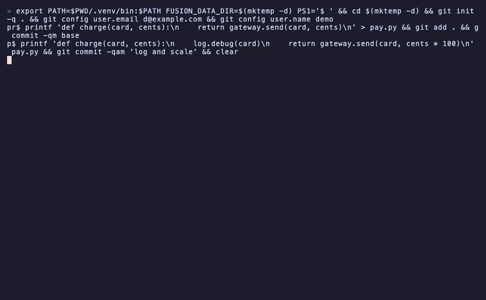
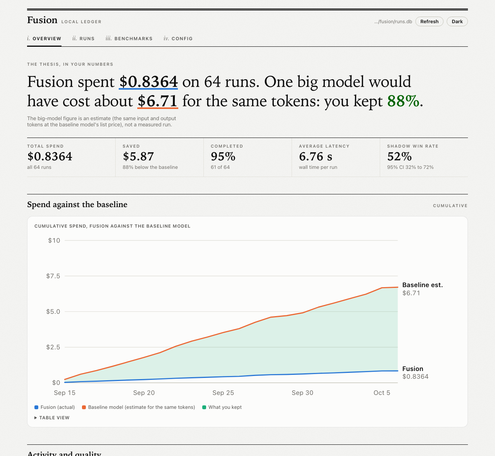

# Fusion Code Orchestrator

[](https://github.com/alexandre0sheva/fusion-code-orchestrator/actions/workflows/ci.yml)
[](LICENSE)
[](pyproject.toml)

A panel of small, cheap LLMs that answers coding questions for Claude Code (and Cursor) over MCP,
plus the instrumentation to find out whether that panel can match a single frontier model on cost,
speed and quality.

Claude Code stays the coding agent. Fusion is an advisor: it takes a diff, an error, a design
question or a feature request, asks a panel of cheap models in parallel, merges their answers, and
returns the result with token, cost and latency telemetry. It never edits files or runs commands.

> **Thesis, tested in the 0.3.0 study:** a panel of cheap models can give advice close to a
> frontier model's for a fraction of the cost and time. The measured answer, below: **cheaper,
> yes; faster, yes; better, not shown, and one cheap model alone did as well.** Docs and
> evidence: **[the website](https://alexandre0sheva.github.io/fusion-code-orchestrator/)**; each release: [changelog](CHANGELOG.md).

## Does a cheap panel match a frontier model?

On 47 held-out tasks with ground truth (all review, debugging, architecture and planning tasks of
the v2 test split, plus 7 coding, frontend and performance tasks), one repeat, neutral judges, $4.42
of live API spend (the 0.3.0 study, 2026-11-19):

| | Quality (95% CI) | Cost per solved task | Median seconds |
|---|---|---|---|
| Claude Opus 5.5 alone | 0.59 [0.50, 0.68] | $0.128 | 20.7 |
| GPT-6.2 Sol alone | 0.48 [0.38, 0.58] | $0.047 | 20.7 |
| Claude Haiku 5.5 alone | 0.64 [0.55, 0.73] | $0.002 | 6.7 |
| GPT-6 Luna alone | 0.54 [0.43, 0.65] | $0.001 | 9.7 |
| Fusion `auto` (default during the study) | 0.61 [0.52, 0.70] | $0.014 | 13.2 |
| **Fusion `panel-nano-pick` (default now)** | 0.60 [0.49, 0.71] | $0.008 | 11.2 |


- **Cheaper: yes.** `panel-nano-pick` costs about 0.06x Opus per solved task (0.04 to 0.09).
- **Faster: yes.** About 0.5x Opus's time per task (0.47 to 0.53); 0.2.0's panel was 1.5x slower.
- **Better or not worse than Opus: the study cannot tell.** The quality difference is +0.01 with an
  interval of -0.08 to +0.10, wider than the 0.03 margin.
- **A cheap model alone did as well.** Haiku 5.5 alone scored highest at about a fifth of the
  default's cost (on dev, panels beat it); the case rests on cost and speed against Opus.
- **Inside Claude Code** (4 coding tasks per arm, too few to rank): every arm but Haiku without
  Fusion (3 of 4) solved all; Fusion's tools doubled host cost and were called in 2 of 12 runs.

Read the limitations before quoting a number. Everything, with the method, the dev-split studies
and the unedited verdicts: [docs/BENCHMARK_RESULTS.md](docs/BENCHMARK_RESULTS.md) and the
[interactive report](docs/benchmark-report.html).

## Limitations

- The study is small (47 tasks, 1 repeat) and its intervals are wide, so "not worse than Opus" is
  *inconclusive*, not *equal*. Most tasks are synthetic, and no person has reviewed them yet.
- Redaction is pattern-based and can miss a secret; answers are advice to check, not instructions.
- Not on PyPI: install from GitHub (`uvx --from git+https://github.com/alexandre0sheva/fusion-code-orchestrator`;
  append `@v0.3.0` to pin the release).

The full list is in the [changelog](CHANGELOG.md#known-limitations) and [SECURITY.md](SECURITY.md#known-limitations).

## What Fusion is and is not

- It is a companion model panel behind MCP tools: review, debug, architecture, planning, general
  answers, answer evaluation, and cost/quality comparison against a baseline.
- It is not a hidden side-effect runner and it does not change Claude Code's model selector. Claude
  Code applies edits and runs tests itself, using Fusion's answer like another model response.
- It calls Anthropic, OpenAI and Google (plus optional Ollama / LM Studio) directly through provider
  adapters. There is no model aggregator in between, so routing, pricing, redaction and failure
  behaviour are visible in the code.

## Quickstart

Requirements: Python 3.11+, [uv](https://docs.astral.sh/uv/), and at least one of
`ANTHROPIC_API_KEY`, `OPENAI_API_KEY`, `GOOGLE_API_KEY`.

```bash
git clone https://github.com/alexandre0sheva/fusion-code-orchestrator.git
cd fusion-code-orchestrator
uv sync --all-groups
cp .env.example .env          # then add your API keys
```

Verify with a live smoke test, or offline without keys:

```bash
uv run python evals/runners/compare_pipelines.py          # live, costs a few cents
uv run python evals/runners/compare_pipelines.py --mock   # offline
uv run fusion review-diff --file path/to/diff.patch       # review a diff
```

**Use it in Claude Code** (no clone needed; three commands):

```bash
export ANTHROPIC_API_KEY=...   # and/or OPENAI_API_KEY, GOOGLE_API_KEY
uvx --python '>=3.11' --from git+https://github.com/alexandre0sheva/fusion-code-orchestrator fusion install claude-code --plugin
claude                         # then try /fusion:review, /fusion:debug or /fusion:ask
```



*`fusion review-diff --diff-ref` on a throwaway repository, offline with `--mock`: canned answers, no API call (tape: [demo.tape](docs/assets/demo.tape)).*

Options, the server-only install, Cursor (`fusion install cursor`), Codex (`fusion install codex`) and troubleshooting: [docs/INTEGRATIONS.md](docs/INTEGRATIONS.md).

## How it works


Panel calls run concurrently and tolerate partial failure. Which models run is a *strategy*
(`fusion strategies list`). The default, `panel-nano-pick`, asks three `nano` models and one cheap
call picks the best answer; `auto` routes by difficulty
([how](docs/CONFIGURATION.md#difficulty-routing-strategy-auto)). The baseline is Claude Opus 5.5 (`high`). Tiers come from price ([COSTS.md](docs/COSTS.md#price-tiers)). `panel-refine`, the `high` budget,
also has the panel models revise their answers after seeing anonymized peer answers
(mixture-of-agents). Every run is stored in
SQLite and compared against a baseline model; an opt-in shadow mode also calls the real baseline and
records a blind pairwise verdict. Details: [docs/ARCHITECTURE.md](docs/ARCHITECTURE.md).

## MCP tools

| Tool | Description |
|------|-------------|
| `fusion_ask` | General model-like coding answer |
| `fusion_review_diff` | Multi-model code review |
| `fusion_debug_error` | Debug analysis with fix recommendations |
| `fusion_plan` | Implementation plan (`kind: feature`) or architecture decision (`kind: decision`) |
| `fusion_propose_patch` | Patch from checks the panel wrote, run in a sandbox copy; returned as a diff to apply |
| `fusion_eval_answer` | Answer quality evaluation |
| `fusion_compare_claude_runs` | Compare Claude Code + Opus vs Claude Code + Fusion |
| `fusion_stats` | Cumulative spend vs baseline, savings, shadow A/B win-rate |
| `fusion_digest` | Cheap models read large files or a diff and answer one question briefly |

Inputs (`paths`, `globs` and `diff_ref` let Fusion read files and `git diff` itself, read-only),
response envelope and budgets: [docs/INTEGRATIONS.md](docs/INTEGRATIONS.md#mcp-tool-reference).

## Common commands

```bash
uv run fusion doctor                              # is this machine ready? (keys, config, MCP server)
uv run fusion ask "Why does this retry loop never back off?" -f src/http.py
git diff main | uv run fusion review-diff -f -    # review a diff
uv run fusion debug --file trace.txt              # debug an error
uv run fusion stats                               # spend, savings, host tokens saved, latest A/B, shadow win-rate
uv run fusion dashboard                           # local web view of spend, runs, benchmarks (read-only)
uv run fusion --help                              # everything else
```



*`fusion dashboard` (synthetic demo data). Details: [docs/CONFIGURATION.md](docs/CONFIGURATION.md#dashboard).*

Every run command takes `--mock` (offline, no keys), `--json`, `--strategy` and `--max-cost`.
Flags, exit codes, the live view and shell completion: [docs/CONFIGURATION.md](docs/CONFIGURATION.md#command-line).

## Documentation

| Topic | Document |
|-------|----------|
| Internals and data flow | [docs/ARCHITECTURE.md](docs/ARCHITECTURE.md) |
| Env vars, YAML config, strategies, budgets | [docs/CONFIGURATION.md](docs/CONFIGURATION.md) |
| Cost and pricing methodology | [docs/COSTS.md](docs/COSTS.md) |
| Measuring Fusion vs a single model | [docs/BENCHMARKING.md](docs/BENCHMARKING.md) |
| Claude Code / Cursor / Codex setup, tool reference | [docs/INTEGRATIONS.md](docs/INTEGRATIONS.md) |
| Claude Code A/B (`fusion bench e2e`, manual runbook) | [docs/CLAUDE_CODE_AB.md](docs/CLAUDE_CODE_AB.md) |
| Security model | [SECURITY.md](SECURITY.md) |
| Contributing and docs rules | [CONTRIBUTING.md](CONTRIBUTING.md) |
| Release history | [CHANGELOG.md](CHANGELOG.md) |

## Project structure

```text
src/fusion/
  mcp_server/     MCP tool handlers and schemas
  orchestration/  pipelines, fan-out, refinement, synthesis, prompts
  providers/      direct API adapters (anthropic, openai, google, ollama, lmstudio, mock)
  routing/        classifier, model registry, budget, policy
  config/         YAML registries and env loading
  evals/          LLM judge and deterministic checks
  benchmark/      shadow A/B baseline comparison
  bench/          `fusion bench`: ground-truth studies, planner, simulated models
  telemetry/      usage, cost, baseline comparison
  security/       secret redaction, untrusted-text delimiters, output cleaning
  storage/        SQLite run store
  cli/            Typer CLI
  dashboard/      `fusion dashboard`: read-only local web UI
  install/        `fusion install`: one-command client setup
plugin/           Claude Code plugin (commands, skills, subagent, MCP config)
evals/, tests/    datasets and runners; the offline pytest suite (mock providers)
```

## Development

```bash
uv sync --all-groups
uv run pytest -q && uv run ruff check src tests evals && uv run mypy
```

Tests run offline; see [CONTRIBUTING.md](CONTRIBUTING.md).

## License

MIT, see [LICENSE](LICENSE).
