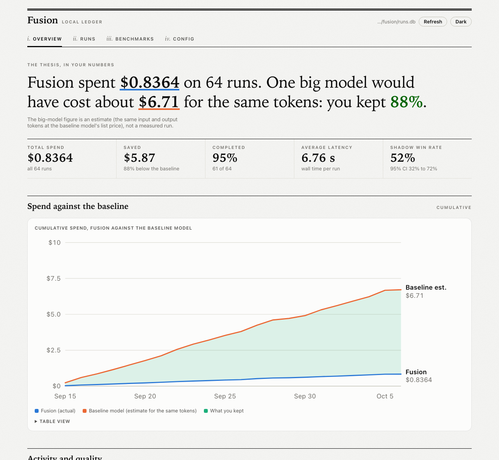

# Fusion Code Orchestrator

**A panel of small, cheap LLMs advises Claude Code over MCP, and the project measures whether that
panel can match one frontier model on cost, speed and quality.** Claude Code stays the executor:
Fusion returns text (a review, a diagnosis, a plan, a patch to apply) and never edits files or runs
anything in your project.

<div class="hero-links" markdown>
[Quickstart](#quickstart){ .md-button .md-button--primary }
[The evidence](BENCHMARK_RESULTS.md){ .md-button }
[Source on GitHub](https://github.com/alexandre0sheva/fusion-code-orchestrator){ .md-button }
</div>

## The verdict

The 0.3.0 study: 47 held-out tasks with ground truth, one repeat, neutral judges, $4.42 of live API
spend (2026-11-19). The default panel, `panel-nano-pick`, against Claude Opus 5.5 alone:

<div class="verdict" markdown>
<div markdown>
**Cheaper: yes**

About 0.06x Opus's cost per solved task.
</div>
<div markdown>
**Faster: yes**

About 0.5x Opus's time per task; 0.2.0's panel was 1.5x slower.
</div>
<div markdown>
**Better: not shown**

The quality difference is inside the margin, and one cheap model alone did as well.
</div>
</div>


The study is small, so "not worse than Opus" is *inconclusive*, not *equal*. The numbers, the method,
the unedited verdicts and the limitations are in [Benchmark results](BENCHMARK_RESULTS.md); the same
data is in the [interactive report](benchmark-report.html), and the run inside a Claude Code session is
in [Claude Code A/B](CLAUDE_CODE_AB.md).

## Quickstart

```bash
export ANTHROPIC_API_KEY=...   # and/or OPENAI_API_KEY, GOOGLE_API_KEY, OPENROUTER_API_KEY
uvx --python '>=3.11' --from git+https://github.com/alexandre0sheva/fusion-code-orchestrator fusion install claude-code --plugin
claude                         # then try /fusion:review, /fusion:debug or /fusion:ask
```

Not on PyPI: install from GitHub. Cursor, Codex, the server-only install and troubleshooting are in
[Integrations](INTEGRATIONS.md).

## See what it does



*`fusion dashboard`: spend against the baseline model, runs and benchmarks, read-only (synthetic demo
data).*

## Where to go next

| I want to | Read |
|-----------|------|
| Set it up in Claude Code, Cursor or Codex; see every tool's inputs | [Integrations](INTEGRATIONS.md) |
| Change models, strategies, budgets or the CLI's behaviour | [Configuration](CONFIGURATION.md) |
| Understand the pipeline: lenses, `select`, escalation, verified patches | [Architecture](ARCHITECTURE.md) |
| See how cost and price tiers are computed | [Costs](COSTS.md) |
| Know what is sent where, and what is redacted | [Security](../SECURITY.md) |
| Reproduce or extend the measurements | [Benchmarking](BENCHMARKING.md) |
| See what changed in each release | [Changelog](../CHANGELOG.md) |
